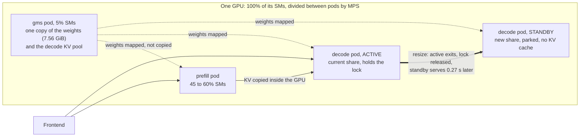

# PoC: resizing prefill and decode on ONE GPU, and sharing one copy of the model

Follow-up to [the PoC](../poc-small-model-disagg-on-one-gpu/README.md) that ran prefill and decode as two GPU fractions of the same
GPU. Two questions: can the compute split between them be changed while serving,
and can they share the model in GPU memory instead of loading it twice?

## Result

Qwen3-4B on one A100 80GB, Dynamo 1.5.0 unmodified, 2026-11-10.

| Question | Answer |
|---|---|
| Is the split worth changing? | **Yes.** Same GPU, same load: 480 tok/s at one split, 295 tok/s at another. |
| Change it on a running engine? | **No.** The driver refuses while a process is attached. |
| Change it by replacing the pod? | **Yes, but it is an outage**: 80 to 96 s with nothing serving. |
| Change it with a standby engine? | **Decode: yes**, the standby serves 3 to 8 s after the old one is removed. **Prefill: no**, broken in Dynamo 1.5.0. |
| Share one copy of the weights? | **Yes.** 23.0 GB used instead of 31.4 GB, same KV cache sizes. |
| Share the KV cache (zero copy)? | **Not tested.** Still copied from prefill to decode. |
| Does it beat one aggregated engine? | **Partly.** About the same throughput, inter-token latency 2.5x better at 32 concurrent, TTFT worse. |

### Against one aggregated engine on the whole GPU

Same box, CUDA graphs on (no `--enforce-eager`) for both layouts:

| Layout | 32 concurrent (AIPerf): tok/s, TTFT, inter-token | 16 concurrent: tok/s, TTFT, inter-token |
|---|---|---|
| Aggregated, whole GPU | 407, 1.0 s, 71 ms | 455, 0.42 s, 32 ms |
| Prefill 60% + decode 35%, shared weights | **413**, 5.8 s, **28 ms** | **481**, 0.69 s, **28 ms** |

The split layout gives slightly more throughput and a flat inter-token latency
(2.5x better at 32 concurrent). It does not beat aggregated on TTFT: prefill only
has 60% of the GPU, and a 5x larger prefill KV cache made no difference, so that
gap is compute, not memory. It is a trade of first-token time for steady token
delivery, not a win on every axis.

### The split matters

16 concurrent requests, 3.5k-token prompts, 128 output tokens (these runs used
`--enforce-eager`):

| Prefill / decode share of the GPU's SMs | Output tok/s | TTFT | Inter-token latency |
|---|---|---|---|
| 60% / 35% | 480 | 0.55 s | 29 ms |
| 45% / 35% | 383 | 1.6 to 2.0 s | 27 to 29 ms |
| 45% / 15% | 325 | 0.55 s | 45 ms |
| 35% / 60% | 295 | 3.8 s | 24 ms |

Prefill's share drives throughput and TTFT; decode's share drives inter-token
latency. The right split depends on the workload, which is why being able to
change it matters.

### One copy of the weights

| | Loaded twice | Shared through GMS |
|---|---|---|
| GPU memory used | 31.4 GB | **23.0 GB** |
| Weights | 7.56 GiB in each engine | 7.56 GiB once |
| Prefill / decode KV cache | 2.96 / 10.34 GiB | 2.87 / 9.89 GiB |

## The idea in one paragraph

The share of the GPU each engine gets is fixed when its process starts, so
"resizing" means replacing the engine with one started at a different share.
Done naively that is over a minute of downtime, almost all of it engine start-up
(the weights take 1.4 s once they are shared). A standby engine removes the wait:
it starts in the background at the new share, maps the shared weights, parks
without a KV cache, and takes over in 0.27 s when the active engine exits.

## Layout

## What we deployed

All pods are GPU fractions of the same card (KAI-Scheduler + kai-gpu-fractioning).

| Pod | SMs | Role |
|---|---|---|
| `gms` | 5% | Dynamo GPU Memory Service: owns the weights, and the KV pool for standby-capable engines |
| `prefill` | 35 to 60% | `--load-format gms` |
| `decode` (active) | 15 to 60% | `--load-format gms --gms-shadow-mode` |
| `decode` (standby) | the new share | same flags, parked until the active one exits |

Resize = start a standby at the new share, wait about 70 s for it to park, delete
the active pod.

## Problems we hit

**1. No live change.** `nvidia-cuda-mps-control namespace set` on a running pod:
`Namespace has clients attached, rejecting active thread percentage update`. Same
for the memory limit. A new process in the same pod does pick up a new share.

**2. Replacing a pod takes the model down.** With no prefill worker, or no decode
worker, every request is rejected (503 / 404) until the replacement is ready.
Decode does not fall back to doing its own prefill, and the frontend does not
hold requests.

**3. Shared weights broke KV sizing.** The mapped weights count against each pod's
memory cap, but vLLM did not see them and sized its KV cache too large; both
engines ran out of memory. Workaround: lower `--gpu-memory-utilization` (0.80 to
0.29 for prefill, 0.75 to 0.45 for decode).

**4. After a decode swap, prefill stalls for up to 30 s.** It keeps holding the KV
blocks of requests the old decode never fetched, until a lease expires.

**5. Requests in flight on the old decode are lost.** With a hard kill the frontend
never fails them, and clients hang until their own timeout.

**6. A standby prefill does not work.** GMS allows one KV-pool writer per GPU, so it
blocks behind the active decode. With a second GMS instance as a workaround it
starts, but its KV handshake thread crashes (`KeyError: (0, 0)`) and every
request through it fails.

**7. A standby is not free.** It holds its full SM share and memory booking while
parked, and KAI will not book past 100% of SMs.

## What has to be fixed to support this

| # | Problem | Owner |
|---|---|---|
| 1 | Standby (shadow) mode for a prefill engine | Dynamo vLLM integration / GMS |
| 2 | One KV pool per engine group, not one per GPU | Dynamo GMS |
| 3 | Hold requests for a few seconds while a role has no worker, instead of 503 / 404 | Dynamo frontend / router |
| 4 | Release prefill's KV blocks when their decode is gone | vLLM NIXL connector / Dynamo |
| 5 | Drain or hand over in-flight requests when a decode is replaced; fail streams whose worker vanished | Dynamo worker lifecycle / frontend |
| 6 | One operator or planner action that does standby, swap and clean-up | Dynamo operator / planner |
| 7 | KV sizing and memory booking with shared weights under fractions | Dynamo GMS, KAI |
| 8 | A standby that does not hold SM share and memory, or a surge allowance during a swap | KAI / kai-gpu-fractioning |
| 9 | Live update of a namespace's share with clients attached (would make 1 to 6 and 8 unnecessary for compute) | CUDA MPS |

Shortest path to a usable resize: 3, 4 and 6 for decode; 1 and 2 for prefill.

## Evidence

- [`tests/08-live-resize-and-shared-weights/RESULTS.md`](../tests/08-live-resize-and-shared-weights/RESULTS.md):
  live change refused, same-pod process restart, shared weights, memory accounting.
- [`tests/09-resize-by-pod-replacement/RESULTS.md`](../tests/09-resize-by-pod-replacement/RESULTS.md):
  splits under load, kill-then-start, standby decode, standby prefill, start-up breakdown.
- Each folder has a `CHANGELOG.md` with every change and failure, the manifests
  and scripts used, and the raw timelines.

## Caveats

One run per scenario; 4B model only; an 80 GB card rather than the 40 GB card of
the first PoC; the swap and split-comparison runs used `--enforce-eager` as before, the
aggregated comparison did not; swap timings come
from a simple closed-loop load generator, the split comparison was also confirmed
with AIPerf (398 vs 251 tok/s at concurrency 32).
